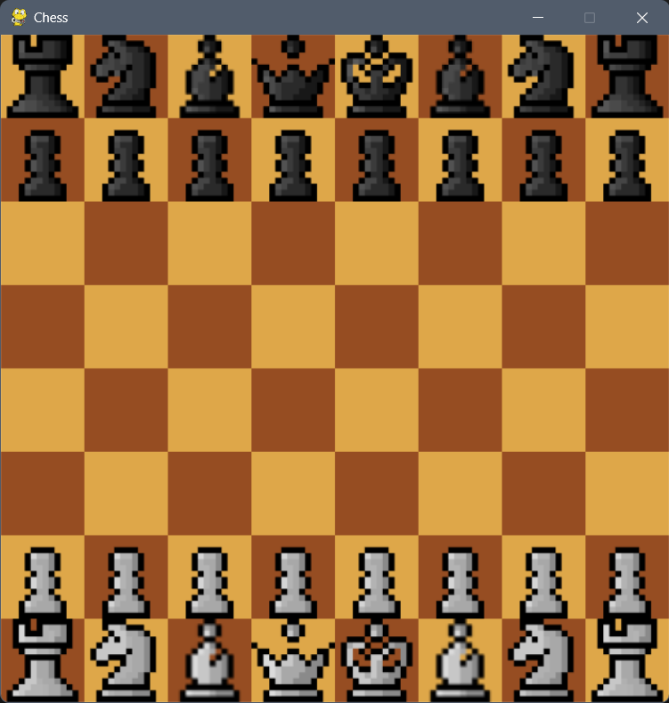

# Chess

A feature-rich Chess game built with Pygame, implementing complex chess mechanics and planning for AI integration and online multiplayer.

## Overview

This Chess game recreates the classic board game with a focus on accurate piece movement and advanced features. The current version includes sophisticated pawn mechanics and a clean UI built with Pygame. Future versions will introduce AI opponents and online connectivity.

## Features

### Current Implementation

**Advanced Pawn Mechanics:**
- Pawns can move up to 3 spaces on their first move
- Queen promotion when a pawn reaches the opposite end of the board
- Proper pawn capture mechanics

**Core Chess Features:**
- Complete piece movement (King, Queen, Rook, Bishop, Knight, Pawn)
- Turn-based gameplay
- Move validation
- Check and checkmate detection (basic)
- Visual board representation with Pygame

### Planned Features

**UI/UX Improvements:**
- Enhanced visual design
- Better piece graphics
- Improved board aesthetics
- Move history display

**Advanced Mechanics:**
- Castling
- En passant
- Additional move validation rules
- Draw conditions (stalemate, repetition, 50-move rule)

**AI Opponents:**
- Basic AI opponent for casual play
- Advanced learning AI that adapts to your playing style
- Difficulty levels

**Online Features:**
- Multiplayer gameplay with friends
- Play against custom AI versions
- Real-time move synchronization


## Usage

Run the game:
```bash
python main.py
```

## Screenshots




## Controls

- **Left Click** - Select and move pieces

## Project Roadmap

1. **Phase 1** - UI/UX improvements and visual polish
2. **Phase 2** - Complete move validation and all chess rules
3. **Phase 3** - Basic AI implementation
4. **Phase 4** - Advanced learning AI
5. **Phase 5** - Online multiplayer connectivity

## Contributing

Contributions are welcome! Whether you're interested in improving the UI, implementing new features, or adding AI functionality, feel free to submit pull requests.

## License

This project is open source and available under the [MIT License](LICENSE).
